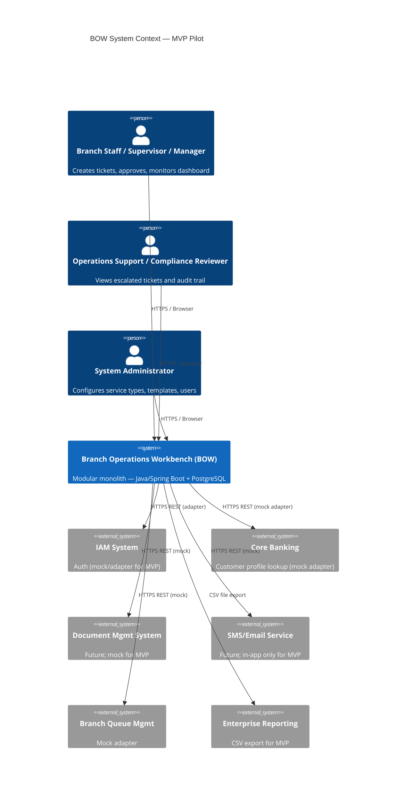

# Architecture / Solution Design

> _AI-generated via LiteLLM (architecture.md) — **unverified** until approved._

Now I have sufficient technical grounding. I'll draft the complete architecture document.

# Architecture / Solution Design

## 1. Executive Summary and Architecture Drivers

**Product:** Branch Operations Workbench (BOW) — MVP Pilot
**Delivery window:** 3 months; 3–5 pilot branches; 8–12 week pilot run.

Key drivers (from PRD §4, §8, §11):

| Driver | Source | Architectural Implication |
|---|---|---|
| 3-month delivery constraint | PRD §12 | Simplest viable topology; no distributed systems overhead |
| 99.5% availability Mon–Sat 07:00–20:00 | NFR-003 | Active + single warm standby; automated failover |
| RTO ≤1 h, RPO ≤15 min | Discovery | WAL-based streaming replication + 15-min snapshots |
| Audit immutability (NFR-007) | G-5 | Append-only audit table; no DELETE/UPDATE API exposed |
| RBAC + PII masking (NFR-004/005) | G-5 | Server-side enforcement; role-filtered query projections |
| Graceful integration degradation (NFR-008) | G-2 | Adapter pattern with circuit-breaker; mock stubs for MVP |
| Scale to 50 branches / 500 concurrent (NFR-010) | G-2 | Stateless app tier; connection pool; horizontal-ready design |
| Private cloud / bank-operated platform | Discovery | OCI/OpenShift container deployment; bank CI/CD toolchain |

---

## 2. Constraints and Assumptions

**Constraints:**
- Deployment: bank's private cloud (OpenShift or VMware); bank container registry and CI/CD (Jenkins/GitLab CI).
- Stack: Java 17 + Spring Boot 3.x + PostgreSQL 15+.
- No financial transaction execution or core banking ledger posting (PRD §9 constraint).
- Mock adapters acceptable for all 6 in-scope integrations at MVP launch.
- Single deployable unit (modular monolith); no microservices split in MVP.

**Assumptions:**
- Assumption: OpenShift is the target container platform; VMware fallback uses Docker Compose on VMs.
- Assumption: IAM integration falls back to local Spring Security user store for MVP (OQ-05 resolved; IAM name TBD per OQ-04).
- Assumption: Data retention = 7 years per banking norm (NFR-006; OQ-08 pending legal confirmation).
- Assumption: Per-service SLA defaults to 1 business day until OQ-02 resolved with operations team.
- Assumption: Feature flags implemented via a `feature_flags` configuration table in PostgreSQL; no external flag service required for MVP.
- Assumption: UI language is Thai primary with English field labels (UX-006; OQ-06 non-blocking).
- TBD: Maker-checker scope beyond exception cases (OQ-03); architecture supports configurable routing rules.

---

## 3. System Context



---

## 4. Architecture Decisions

| ID | Decision | Rationale | Alternatives Considered | Consequences |
|---|---|---|---|---|
| AD-01 | Modular monolith (single JAR) | 3-month timeline; pilot scale (≤50 concurrent); avoids distributed systems complexity | Microservices (over-engineered for MVP scale) | Simpler ops; module boundaries enforced by Java packages; horizontal split deferred post-pilot |
| AD-02 | Synchronous audit write in same DB transaction | Guarantees audit completeness (NFR-007, G-5); rollback atomicity | Async event bus (risks audit loss on failure) | Slight write latency increase; acceptable at pilot scale |
| AD-03 | PostgreSQL streaming replication + WAL archiving | Meets RPO ≤15 min; native to PostgreSQL; no additional tooling | Logical replication, external backup tools | Requires standby instance; WAL archive storage on bank NAS/S3-compatible store |
| AD-04 | Adapter pattern for all integrations | Enables mock-to-real swap without core changes (NFR-008, R-01) | Direct HTTP calls (tight coupling) | Adapter interface per integration; mock implementations ship with MVP |
| AD-05 | Spring Security with method-level `@PreAuthorize` | Server-side RBAC enforcement (NFR-004); integrates with Spring Boot 3.x natively | External policy engine (OPA) — overkill for MVP | Role hierarchy defined in DB; permission checks on service layer |
| AD-06 | Append-only `audit_event` table; no UPDATE/DELETE granted to app role | Immutability (NFR-007); enforced at DB privilege level | Application-layer guard only (bypassable) | Separate DB role `bow_audit_writer` with INSERT-only on audit table |
| AD-07 | Server-side PII projection by role | Masking in query layer (NFR-005); not in UI only | UI-only masking (bypassable via API) | Role-aware repository projections; masked DTOs returned to unauthorized roles |

---

## 5. Component Design and Responsibilities

```
bow-app (single Spring Boot JAR)
├── module: intake          — FR-001, FR-002, FR-003 (ticket creation, checklist load)
├── module: queue           — FR-005, FR-006 (queue view, assignment)
├── module: workflow        — FR-007, FR-008, FR-009, FR-010 (approval routing, maker-checker)
├── module: documents       — FR-004 (attachment tracking)
├── module: tracking        — FR-011, FR-015 (open/pending/escalated view, reopen)
├── module: dashboard       — FR-012, OBS-002, OBS-003, OBS-004 (metrics, CSV export)
├── module: audit           — FR-013, NFR-007 (append-only audit event writer)
├── module: admin           — FR-014 (service type, template, user config)
├── module: integration     — Adapter interfaces + mock implementations
│   ├── CoreBankingAdapter  (mock)
│   ├── IamAdapter          (mock → real)
│   ├── NotificationAdapter (mock)
│   └── QueueAdapter        (mock)
└── module: security        — NFR-004, NFR-005 (RBAC, PII projection, Spring Security config)
```

**Cross-cutting:** Correlation ID filter (OBS-001); global exception handler; transaction management (AD-02).

---

## 6. Data Architecture

### Core Tables (PostgreSQL)

| Table | Key Columns | Notes |
|---|---|---|
| `branch` | id, name, code, timezone | Seed data per pilot branch |
| `branch_user` | id, branch_id, role, username_hash | Role: STAFF, SUPERVISOR, MANAGER, OPS_SUPPORT, COMPLIANCE, ADMIN |
| `service_type` | id, name, sla_minutes, approval_required | Configurable (FR-014) |
| `checklist_template` | id, service_type_id, version, effective_from | Version-stamped (FR-014) |
| `checklist_item` | id, template_id, label, mandatory, order | |
| `service_ticket` | id, branch_id, service_type_id, customer_ref, status, sla_due_at, created_by, template_version | Status enum: WAITING, IN_PROGRESS, PENDING_APPROVAL, RETURNED, COMPLETED, FOLLOW_UP |
| `checklist_response` | id, ticket_id, item_id, completed, exception_reason | FR-003 |
| `document_attachment` | id, ticket_id, doc_type, status, storage_ref, notes | Status: RECEIVED, MISSING |
| `approval_request` | id, ticket_id, requested_by, assigned_to, status | |
| `approval_decision` | id, approval_request_id, decided_by, action, comment, decided_at | Action: APPROVED, REJECTED, RFI |
| `follow_up_task` | id, ticket_id, assigned_to, due_at, status | |
| `audit_event` | id, ticket_id, user_id, action_type, before_state jsonb, after_state jsonb, occurred_at | INSERT-only; no UPDATE/DELETE (AD-06) |
| `feature_flags` | key, enabled, description | MVP feature toggle (Assumption) |

**Retention:** All tables subject to 7-year retention policy (NFR-006). Soft-delete via `archived_at` column; hard purge via scheduled job after retention window.

**Indexing:** `service_ticket(branch_id, status)`, `service_ticket(sla_due_at)`, `audit_event(ticket_id, occurred_at)`.

---

## 7. API, Event, and Integration Contracts

### Internal REST API (Spring MVC, JSON)

| Method | Path | Module | FR/NFR |
|---|---|---|---|
| POST | `/api/tickets` | intake | FR-001 |
| GET | `/api/tickets/{id}/checklist` | intake | FR-002 |
| PATCH | `/api/tickets/{id}/checklist-items/{itemId}` | intake | FR-003 |
| POST | `/api/tickets/{id}/documents` | documents | FR-004 |
| GET | `/api/tickets` | queue | FR-005 |
| PATCH | `/api/tickets/{id}/assignment` | queue | FR-006 |
| POST | `/api/tickets/{id}/submit-approval` | workflow | FR-007 |
| POST | `/api/approvals/{id}/decide` | workflow | FR-008/009/010 |
| POST | `/api/tickets/{id}/reopen` | tracking | FR-015 |
| GET | `/api/dashboard/summary` | dashboard | FR-012 |
| GET | `/api/reports/kpi.csv` | dashboard | OBS-004 |

All endpoints: JWT bearer auth; correlation ID header `X-Correlation-ID`; versioned under `/api/v1/` post-MVP.

### Integration Adapter Contracts

| Adapter | Interface Method | MVP Impl | Real Trigger |
|---|---|---|---|
| `CoreBankingAdapter` | `CustomerProfile findByRef(String ref)` | Returns mock fixture | Post-pilot CBS API available |
| `IamAdapter` | `UserDetails authenticate(String token)` | Local Spring Security store | IAM system confirmed |
| `NotificationAdapter` | `void send(Notification n)` | No-op log | Post-MVP |
| `QueueAdapter` | `void updateQueueStatus(String ticketId, Status s)` | No-op log | Post-MVP |

**Circuit-breaker:** Resilience4j `@CircuitBreaker` on each adapter; open state returns graceful error to UI (NFR-008).

---

## 8. Deployment Topology and Environments

```mermaid
graph TD
    subgraph Bank Private Cloud (OpenShift / VMware)
        LB[Load Balancer / Ingress]
        APP1[BOW App Pod — Primary]
        APP2[BOW App Pod — Warm Standby]
        DB1[(PostgreSQL Primary)]
        DB2[(PostgreSQL Standby — streaming replication)]
        WAL[WAL Archive — NAS/Object Store]
        REG[Bank Container Registry]
    end
    Browser -->|HTTPS| LB
    LB --> APP1
    LB -.failover.-> APP2
    APP1 --> DB1
    APP2 -.read/failover.-> DB1
    DB1 -->|WAL stream| DB2
    DB1 -->|WAL archive every 15 min| WAL
```

### Environments

| Env | Purpose | DB | Notes |
|---|---|---|---|
| DEV | Developer local | Docker Compose (PG) | Mock all adapters |
| SIT | Integration testing | Dedicated PG instance | Bank CI/CD pipeline; mock adapters |
| UAT | Pilot branch acceptance | Pilot-sized PG | Real IAM adapter if available |
| PROD | Live pilot (3–5 branches) | Primary + standby PG | Full resilience config |

**CI/CD:** Bank Jenkins/GitLab CI pipeline: build → unit test → SIT deploy → integration test → UAT gate → PROD deploy. Container image pushed to bank registry; Helm chart or OpenShift template for deployment manifests.

---

## 9. Security, Privacy, and Threat Considerations

| Threat | Control | NFR/FR |
|---|---|---|
| Unauthorized data access | Spring Security RBAC; `@PreAuthorize` on service layer; JWT expiry ≤8 h | NFR-004 |
| PII exposure via API | Role-filtered DTO projections; masked fields for STAFF/OPS roles | NFR-005 |
| Audit tampering | DB role `bow_audit_writer` INSERT-only; no app-level delete endpoint | NFR-007 |
| Self-approval fraud | Server-side maker-checker check: `ticket.createdBy ≠ approver` | FR-010 |
| Data retention breach | Scheduled purge job; `archived_at` soft-delete; 7-year hard delete | NFR-006 |
| Integration injection | Adapter input validation; no raw SQL from external data | NFR-008 |
| Transport interception | TLS 1.2+ enforced at ingress; internal pod-to-DB TLS | NFR-004 |

**Pre-pilot gate:** Penetration test required before PROD go-live (NFR-004). Security review of audit immutability (NFR-007).

---

## 10. Scalability, Reliability, and Performance

- **Pilot load:** ≤50 concurrent users; ≤5 branches. NFR-001 (≤2 s P95), NFR-002 (≤1 s P95) achievable with single app pod + connection pool (HikariCP, pool size 20).
- **Scale path (NFR-010):** Stateless app tier allows horizontal pod scaling to 500 concurrent without schema changes. DB read replicas added when branch count exceeds 20.
- **Availability (NFR-003):** Warm standby pod + PostgreSQL streaming replication. Automated health-check restarts failed pod within minutes. RTO ≤1 h via manual or scripted DB failover to standby.
- **RPO ≤15 min:** WAL archiving every 15 min to NAS; streaming replication provides near-zero lag to standby.
- **Dashboard refresh (FR-012):** Materialized view refreshed every 60 s via scheduled Spring task; avoids live aggregation on every request.
- **SLA tracking (OBS-003):** `sla_due_at` indexed; background job flags breaches every 5 min.

---

## 11. Observability and Operations

| ID | Requirement | Implementation |
|---|---|---|
| OBS-001 | Structured logs with correlation ID | Logback JSON appender; `X-Correlation-ID` propagated via MDC |
| OBS-002 | Dashboard metrics from live data | Materialized view + 60-s refresh scheduler |
| OBS-003 | SLA breach flagging | Scheduled job queries `sla_due_at < now()`; sets `sla_breached = true` |
| OBS-004 | KPI CSV export (M-1–M-6) | `/api/reports/kpi.csv` endpoint; role: MANAGER, ADMIN |
| OBS-005 | Error rate alert >1% / 5 min | Spring Boot Actuator `/actuator/metrics` + bank monitoring (Prometheus/Grafana or equivalent); alert rule configured in bank toolchain |

**Health endpoints:** `/actuator/health`, `/actuator/info` exposed internally; not public-facing.

---

## 12. Testing Strategy

| Layer | Approach | Coverage Target | Tools |
|---|---|---|---|
| Unit | Service and domain logic; mock repositories | ≥80% line coverage | JUnit 5, Mockito |
| Integration | Module-to-DB; adapter mock-to-real swap | All FR-001–FR-015 happy + error paths | Spring Boot Test, Testcontainers (PG) |
| Security | RBAC enforcement; self-approval block; PII masking | All roles × all endpoints | Spring Security Test |
| Performance | P95 latency under 50 concurrent users | NFR-001, NFR-002 | Gatling or k6 in SIT |
| UAT | Pilot branch staff complete core journey | NFR-009 (≤30 min onboarding) | Manual; guided test scripts |
| Penetration | RBAC, audit immutability, transport security | NFR-004, NFR-007 | Bank security team; pre-PROD gate |

---

## 13. Delivery, Migration, and Rollback Strategy

**Greenfield:** No legacy data migration required (discovery: migration = not_applicable).

**Delivery phases:**
- Sprint 1–2: Core schema, RBAC, FR-001/002/003/013 (P1 must-haves), CI/CD pipeline.
- Sprint 3–4: FR-007/008/009/010 (approval workflow), FR-004/005/006 (P2 queue/docs).
- Sprint 5–6: FR-011/012/015, dashboard, CSV export, SIT/UAT.
- Pre-pilot: Penetration test, performance test, UAT sign-off, M-2 baseline capture.

**Rollback:** Blue/green pod swap via OpenShift route or load-balancer weight shift. DB schema changes use Flyway migrations; rollback script required for each migration before merge. Feature flags (`feature_flags` table) allow disabling new capabilities without redeployment.

**Pilot expansion gate:** M-2 (≥80% SLA completion for 4 consecutive weeks) must be met before expanding beyond pilot branches (PRD §4 go/no-go).

---

## 14. Risks and Technical Debt

| ID | Risk | Likelihood | Impact | Mitigation |
|---|---|---|---|---|
| R-01 | Core banking API unavailable | High | Medium | Mock adapter ships day 1; real adapter interface defined (AD-04) |
| R-02 | Staff resistance to new workflow | Medium | High | Simple UI; NFR-009 onboarding target; weekly M-4 tracking |
| R-03 | Scope creep — extra service types | High | Medium | Service type list frozen at PRD §6; change control required |
| R-04 | PII non-compliance | Low | High | NFR-005/006 controls; pen test gate before PROD |
| R-05 | IAM integration delay | Medium | Medium | Local auth fallback (AD-05 assumption); swap to real IAM adapter when available |
| TD-01 | Materialized view refresh is polling-based | — | Low | Acceptable for MVP; replace with event-driven refresh post-pilot |
| TD-02 | Local auth store not enterprise-grade | — | Medium | Must be replaced by real IAM adapter before enterprise rollout |
| TD-03 | CSV export not scalable beyond ~10k rows | — | Low | Replace with streaming export or reporting platform API post-pilot |

---

## 15. Requirement-to-Component Traceability

| Requirement | Priority | Module(s) | AD Reference |
|---|---|---|---|
| FR-001 | P1 | intake | AD-01, AD-02 |
| FR-002 | P1 | intake | AD-01 |
| FR-003 | P1 | intake, audit | AD-02, AD-06 |
| FR-004 | P2 | documents, audit | AD-02 |
| FR-005 | P2 | queue | AD-01 |
| FR-006 | P2 | queue, audit | AD-02 |
| FR-007 | P1 | workflow | AD-01, AD-05 |
| FR-008 | P1 | workflow, audit | AD-02, AD-05 |
| FR-009 | P1 | workflow, audit | AD-02 |
| FR-010 | P1 | workflow, security | AD-05, AD-07 |
| FR-011 | P2 | tracking | AD-01 |
| FR-012 | P2 | dashboard | AD-01, OBS-002 |
| FR-013 | P1 | audit | AD-02, AD-06 |
| FR-014 | P3 | admin | AD-01 |
| FR-015 | P2 | tracking, audit | AD-02 |
| NFR-001/002 | P1 | All (HikariCP, indexed queries) | AD-01 |
| NFR-003 | P1 | Deployment topology | AD-03 |
| NFR-004 | P1 | security | AD-05 |
| NFR-005 | P1 | security | AD-07 |
| NFR-006 | P1 | audit, admin | AD-06 |
| NFR-007 | P1 | audit | AD-06 |
| NFR-008 | P2 | integration | AD-04 |
| NFR-009 | P2 | All (UX simplicity) | AD-01 |
| NFR-010 | P3 | Deployment topology, DB | AD-01, AD-03 |
| OBS-001–005 | — | dashboard, audit, integration | AD-01 |
| M-2 Go/No-Go | Gate | dashboard, tracking | OBS-003 |
